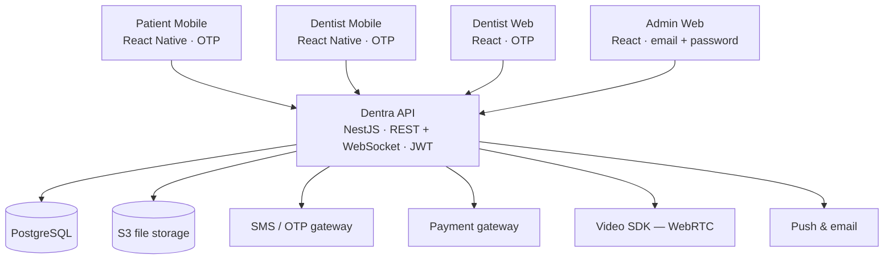
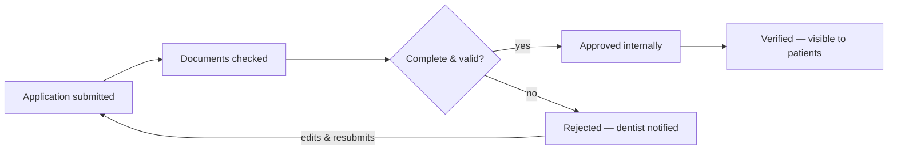
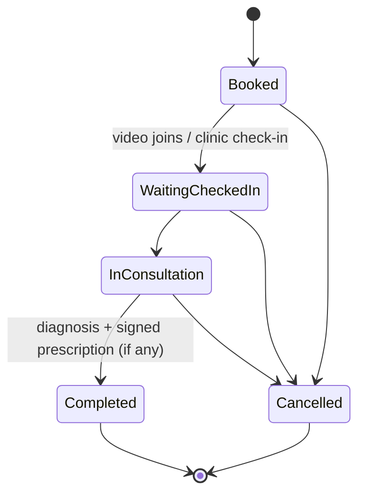

# Dentra: Target Architecture, Onboarding & Flows

*As of 2026-10-15*

Companion files: [`dentra-api/openapi.yaml`](dentra-api/openapi.yaml) (the API contract referenced throughout this document) and [`dentra-api/schema.sql`](dentra-api/schema.sql) (the PostgreSQL DDL it's backed by) — both live inside the `dentra-api` repo, not alongside this document, per the "no shared package" decision below. Every endpoint cited below as `METHOD /path` is defined in `openapi.yaml`.

## Why this can't stay one app

The prototype proves every user journey end to end — booking, consultation, prescriptions, admin verification — by faking every hard part behind it. One HTML file switches between patient, dentist and admin by a role variable; all state lives in the browser's `localStorage`; OTP is a hardcoded `123456`; a payment flips straight to "Paid" with no gateway; a prescription is "signed" by typing a name that string-matches the dentist's own. None of that survives a second device, a second concurrent user, or a compliance review.

Six gaps drive the redesign below:

1. **No backend.** Two patients booking the same slot at once would both "succeed" — there's no transaction or row lock, just a client-side array check.
2. **No real identity.** OTP, e-signatures and KYC checks are client-side theatre with nothing behind them.
3. **One codebase, three trust levels.** A bug shipped to the patient booking screen ships in the same build as the admin dentist-verification screen.
4. **No file storage.** A dentist's KYC "documents" are three booleans (`degree`, `council`, `id`), not actual uploaded files.
5. **No payments, notifications or video provider.** All three are stubbed UI — no gateway, no SMS/push service, no WebRTC.
6. **No compliance trail.** "Download my data" and "delete my account" are rows pushed into an array, not an SLA-tracked process under the DPDP Act, 2023.

The rest of this document fixes the architecture, specifies exactly what a dentist and a patient must submit to onboard, and walks the key flows end to end.

---

## Five independent repos

Split by trust boundary and device, not by "web vs mobile" alone — and no shared package between them.

| App | Platform | Who uses it | Login |
| --- | --- | --- | --- |
| `dentra-api` | Node.js (NestJS) + PostgreSQL | all four clients | — |
| `dentra-web-dentist` | React (web) | dentists, at the clinic desktop | Mobile OTP |
| `dentra-web-admin` | React (web) | platform operations staff | Email + password |
| `dentra-mobile-patient` | React Native (CLI) | patients | Mobile OTP |
| `dentra-mobile-dentist` | React Native (CLI) | dentists, on the go | Mobile OTP |

**No shared `dentra-contracts` package.** Each of the four client apps owns its own API types and request/response models, generated independently from `dentra-api`'s published OpenAPI spec at build time — not pulled in as a shared npm/yarn package. That costs a little duplication (the same `Appointment` shape gets typed four times), but it buys independence: `dentra-web-admin` can ship on its own schedule without a shared-library version bump forcing a release in `dentra-mobile-patient`, and a breaking API change is caught by each app's own contract tests against a staging API, not by untangling a shared dependency graph across four repos.

**Why two dentist apps instead of one responsive one.** A chairside consultation — charting, writing a prescription, signing it — needs a keyboard and a bigger screen, done sitting between patients: that's the web portal's job. Seeing today's queue, getting notified a patient is waiting, or taking a call while walking between rooms is a phone's job: that's the mobile app. Same account, same backend, different UI code.

**Why patient is mobile-only.** Patients book and attend consults from wherever they are; a managed mobile app also gives push notifications, camera access for symptom photos, and native video calling — all weaker on mobile web. There's no `dentra-web-patient`.

**Why admin is the one app without OTP.** Admin accounts are a handful of internal staff the platform provisions itself, not self-registered end users. Email + password fits staff-identity tooling (SSO later) better than SMS OTP. TOTP 2FA was tried and then deliberately removed (see the open assumption below) — it can come back once there's an actual enrollment flow to go with it, rather than a secret printed once to a terminal.

Nothing but the API talks to Postgres, the file store or any third-party provider — every client, including Admin Web, goes through the same REST/WebSocket contract, so a permission bug is one bug, not four.

---

## Authentication: OTP everywhere except the back office

| App | Identity | Login | Session |
| --- | --- | --- | --- |
| Patient Mobile | mobile number | OTP (4-digit SMS) | 15-min access token; rotating refresh token in Keychain/Keystore |
| Dentist Mobile | registered mobile number | OTP | same as above |
| Dentist Web | registered mobile number | OTP | 15-min access token; refresh token in an httpOnly secure cookie |
| Admin Web | work email | password | 30-min session; forced re-auth before destructive actions (disable a dentist, resolve a privacy request) |

**Endpoints:** `POST /auth/otp/request` + `POST /auth/otp/verify` for every OTP login (patient and dentist, both apps); `POST /auth/admin/login` for the back office; `POST /auth/refresh` to rotate an access token; `POST /auth/logout` to revoke one device's refresh token without touching the others.

**OTP rules:** 4 digits (including leading zeros), 5-minute expiry, 30-second resend cooldown, max 5 requests per number per hour, max 5 verify attempts before a 15-minute lock. Only the generated code is accepted; there is no bypass. A code can be consumed only once, including concurrent requests.

**Mobile identities:** a mobile number is unique within a role. The same person can hold separate patient and dentist accounts with that number, each with its own user ID, profile and sessions. The OTP purpose selects the role; signing in never converts an existing account or grants another role's access.

**Tokens:** a short-lived JWT access token (claims: `sub`, `role`, `dentistId`/`patientId`, scopes) plus a rotating refresh token stored server-side per device — so a lost phone can be revoked from Admin Web without forcing every other device to re-login.

**Role scoping at the gateway, not just in the UI:** every request carries a role claim the API enforces server-side (e.g. only `role=dentist` can write a consultation; only `role=admin` can change a dentist's `status`). The prototype's "role switch" was a UI-only illusion — in production the same bypass a user tries in dev tools must fail at the API, not just stay hidden in the UI.

---

## Dentist onboarding: what's collected, and who can start it

Two entry points feed one review queue:

- **Self-serve.** A dentist signs up on Dentist Mobile or Dentist Web, verifies their mobile number by OTP (`POST /auth/otp/request`, `POST /auth/otp/verify`), and submits every section below via `POST /dentists/applications`, followed by one `POST /dentists/applications/{dentistId}/documents` call per KYC file. The application sits as `pending_review` until Admin Web approves or rejects it.
- **Admin-created.** Platform ops creates the dentist record via `POST /admin/dentists` (name, mobile, email, primary clinic) and sends an invite link; the dentist completes credentials, documents and bank details themselves (`PATCH /dentists/me`, `POST /dentists/me/clinics`) before the record can move to `verified`. Admin can also pass `overrideVerify: true` on that same call to mark a dentist `verified` directly after checking documents collected outside the app (e.g. during a sales visit) — but `overrideReason` is then required by the API (422 without it), and the override is written to the audit trail (`GET /admin/audit-log`).

Either path, the dentist never appears to patients until `status = verified`.

### Fields required to onboard a dentist

**Identity**

| Field | Notes |
| --- | --- |
| Full name | as on the registration certificate |
| Mobile number | OTP-verified, primary login |
| Email address | verified via emailed link |
| Date of birth | |
| Gender | |
| Profile photo | shown to patients |

**Professional credentials**

| Field | Notes |
| --- | --- |
| Highest qualification | e.g. BDS, MDS — with college/university and year |
| Specialization | General Dentist, Orthodontist, Endodontist, Periodontist, Oral Surgeon, Prosthodontist, Paediatric Dentist, … |
| Years of experience | |
| State Dental Council registration number | |
| Registering council / state | |
| Registration validity date | triggers a re-verification reminder before it expires |
| Languages spoken | |

**Practice**

| Field | Notes |
| --- | --- |
| Clinic name(s) | a dentist may list more than one clinic; each gets its own address and hours |
| Clinic address + pincode | geocoded for the patient-facing map |
| Clinic phone | |
| Working hours per weekday, per clinic | feeds slot generation |
| Consultation types offered | video, in-clinic, or both — a dentist with no video capability only appears for in-clinic booking |
| Video consult fee | only if video is offered |
| In-clinic visit fee | |

**Payout**

| Field | Notes |
| --- | --- |
| Bank account holder name | |
| Account number + IFSC | |
| PAN | required for tax/TDS on payouts |
| GSTIN | optional |

**KYC documents (actual uploads, not checkboxes)**

| Document | Why |
| --- | --- |
| Degree certificate (BDS/MDS) | proves qualification |
| State Dental Council registration certificate | proves the right to practise |
| Government photo ID (Aadhaar / passport / driving licence) | identity match |
| Clinic establishment proof (Shop & Establishment licence, if in-clinic) | proves the clinic is real |
| Professional indemnity insurance certificate | recommended, not blocking |
| Live selfie | matched against the photo ID, to catch someone onboarding with a stolen degree |

**Consent**

- Platform terms of service
- Telemedicine Practice Guidelines (2020) acknowledgment
- Data processing consent

System-managed fields the dentist never fills in: `status` (`draft → pending_review → verified` / `rejected` / `disabled`), `reviewedBy`, `reviewedAt`, `rejectionReason`, `resubmissionCount`.

| Step | Endpoint |
| --- | --- |
| Application submitted | `POST /dentists/applications` (self-serve) or `POST /admin/dentists` (admin-created) |
| Documents checked | `GET /admin/dentists?status=pending_review` lists the queue; each file is already on record from `POST .../documents` |
| Complete & valid? | decided by admin, not computed — the UI reads `dentist.documents` returned on that same `GET` |
| Approved internally / Verified | `POST /admin/dentists/{dentistId}/approve` (`force: true` if docs are missing, logged the same way as the create-time override) |
| Rejected — dentist notified | `POST /admin/dentists/{dentistId}/reject` with a required `reason` |
| Edits & resubmits | dentist calls `PATCH /dentists/me` / re-uploads documents, then the record re-enters the queue at its existing id — no new `POST /dentists/applications` call |

Both entry points (self-serve signup or an admin-created invite) land in the same `pending_review` queue — there is no shortcut that skips document review except the logged admin override described above.

---

## Patient registration

One path only: self-serve, mobile OTP, on Patient Mobile. There is no admin-created patient account — patients are never onboarded by staff, which keeps the platform out of the business of attesting to a patient's identity.

`POST /auth/otp/request` with a number that has no `Patient` record returns `isNewAccount: true`; the client verifies with `POST /auth/otp/verify` as usual, then must call `POST /patients/register` with everything below before the access token can be used for anything else.

**At signup (mandatory)**

| Field | Notes |
| --- | --- |
| Mobile number | OTP-verified, primary login |
| Full name | |
| Date of birth | drives the guardian flow below if under 18 |
| Gender | |
| Email | optional, used for receipts |
| City | for matching nearby dentists |
| Preferred language | |

**If date of birth indicates the patient is under 18**

| Field | Notes |
| --- | --- |
| Guardian full name | |
| Relationship to patient | |
| Guardian mobile number | OTP goes to the guardian, not the minor |
| Guardian consent | required before any booking; recorded with a timestamp |

**Medical history (collected before the first booking, editable anytime in Profile)**

| Field | Notes |
| --- | --- |
| Known allergies | free text today; structured drug-allergy codes once a formulary exists, so the allergy-conflict check at prescribing time stops being a regex |
| Existing medical conditions | |
| Current medications | |
| Emergency contact | name, relationship, phone |

**Consent**

- Terms of use & privacy policy, with a timestamp
- Consent to share records with the treating dentist (per visit)
- Telemedicine consent, logged per video consultation — required under the Telemedicine Practice Guidelines (2020), not just implied by booking

**Optional, profile completion**

- Profile photo
- Address (for a future home-collection or lab-partner integration)
- Saved payment method — tokenized by the payment gateway's vault; Dentra never stores a card or UPI handle itself

---

## Core domain entities

| Entity | Key fields | Relationships |
| --- | --- | --- |
| `User` | id, role, mobile/email, auth provider | base identity for Patient, Dentist and Admin profiles |
| `Patient` | profile + guardian fields, allergies, conditions, meds, emergency contact | 1 user; many appointments |
| `Dentist` | credentials, status, languages | 1 user; many clinics; many appointments; many onboarding requests (history) |
| `Clinic` | address, geo, hours | belongs to one dentist; a dentist may have several |
| `Appointment` | patient, dentist, clinic, date/time, type (video/clinic), status, payment ref | 1 patient, 1 dentist; 1 consultation (once completed) |
| `Consultation` | findings, diagnosis, treatment, plan, follow-up date | 1:1 with a completed appointment |
| `Prescription` | items[], signedBy, signedAt, signatureRef | 1:1 with a consultation, optional |
| `DentalChart` | tooth map, versioned | belongs to a patient; each entry stamped with who changed it and when — a history, never an overwrite |
| `Transaction` | appointment ref, gateway ref, amount, status | 1:1 with an appointment |
| `Document` | owner type/id, file URL, doc type, verified by | attached to a `DentistOnboardingRequest` or a `Consultation` (lab files, X-rays) |
| `DentistOnboardingRequest` | submittedBy (dentist/admin), status, documents[], reviewer, reason | the review trail behind a dentist's `status` |
| `PrivacyRequest` | patient, type (export/erase), status, SLA due date | tracked against the DPDP Act's response window |
| `Notification` | user, channel, payload, sentAt, readAt | fan-out target for push/SMS/email |
| `AuditLog` | actor, action, entity, before/after, timestamp | written on every state change that affects another party — approvals, disables, refunds, overrides |

Two deliberate departures from the prototype: a dental chart entry is **append-only** (so a patient's history across dentists is reconstructable), and every admin action that affects a dentist or a patient writes an `AuditLog` row — the prototype had neither.

---

## Key flows end to end

### Patient OTP login

1. Patient enters their mobile number on Patient Mobile — `POST /auth/otp/request` with `purpose: patient`.
2. API checks rate limits, generates a 4-digit OTP, and stores a hash of it with a 5-minute expiry; the response carries `otpId`, `expiresInSeconds` and `resendAfterSeconds`. SMS delivery is currently a stub: read the generated code from the backend log until a provider is connected.
3. Patient enters the code — `POST /auth/otp/verify` with that `otpId`; API compares the hash and issues an access + refresh token pair (`AuthTokens`) on a match.
4. A new number with no `Patient` record gets `isNewAccount: true` back from step 1, and must call `POST /patients/register` (the field list above) before the token from step 3 works for anything else.
5. Five failed attempts returns `423` and locks the number for 15 minutes; the UI shows the remaining lockout time, not a generic error.

### Booking a slot without double-booking it

1. Patient picks a dentist, a clinic location (only asked when that dentist has more than one), a date and a 30-minute slot — `GET /dentists/{dentistId}/slots?date=&type=&clinicId=`, which already excludes booked and passed times.
2. On "confirm", `POST /appointments` fires with that date/time/clinicId plus a client-generated `idempotencyKey`. The API opens a database transaction, takes a row lock on that dentist/date/time, and re-checks availability inside the lock — the prototype's race condition (two browser tabs both seeing the slot as free) cannot happen because the second request blocks until the first commits or rolls back, and `appointments_no_double_booking` (a partial unique index in `schema.sql`) refuses it outright even if that application logic has a bug. A slot taken in the gap between step 1 and step 2 comes back as `409`.
3. Payment is authorized through the gateway (or, for pay-at-clinic, skipped) before the transaction commits; if authorization fails, `POST /appointments` returns `402`, the lock releases and the slot is free again.
4. On commit, `POST /appointments` returns `201` with the new `Appointment`; a confirmation is pushed to the patient and a new-booking notification to the dentist.

### Cancellation & refund

1. Patient or dentist cancels from the appointment screen — `POST /appointments/{appointmentId}/cancel`. Already completed or cancelled returns `409`.
2. If the appointment was paid online, cancellation durably queues a full refund and payment moves to `refund_pending`. A background worker submits it with a persisted gateway idempotency key; `refunded` requires a processed provider response or signed webhook. Pay-at-clinic bookings close with no online charge. See [payment behaviour and testing](PAYMENTS.md).
3. The freed slot becomes bookable again immediately — the unique index from the booking flow only blocks non-cancelled rows, so the same dentist/date/time is available to `POST /appointments` again right away.
4. Both parties are notified; a dentist-initiated cancellation inside 24 hours of the slot also flags the appointment for admin review.

### Rescheduling

1. Patient or dentist picks a new date/time for a `booked` appointment, at the same clinic — `POST /appointments/{appointmentId}/reschedule` with `{date, time}`. Not valid once the visit has moved past `booked` (waiting/in-consult/completed/cancelled all return `409`).
2. The API re-runs the same lock-and-recheck booking uses against the new slot; a time taken in the meantime comes back `409` and the old slot is untouched.
3. On success the appointment's `date`/`time` change in place — same id, same payment, same clinic — and both parties are notified of the new time.
4. Moving to a *different* clinic isn't a reschedule: that's a cancel (`.../cancel`) plus a fresh `POST /appointments`, since the two locations may have different hours and fees.

### Patient privacy requests (DPDP Act, 2023)

1. Patient submits a data-export or account-deletion request from Profile — `POST /privacy-requests` with `type: export` or `type: erase`.
2. It lands in Admin Web via `GET /privacy-requests?status=open` with an SLA due date (statutory response window) already set on creation, not just a status string.
3. Admin resolves it with `POST /privacy-requests/{requestId}/resolve` — export triggers a data package generation job; deletion triggers anonymization of the patient's PII while retaining de-identified clinical records where law requires retention.
4. Resolution and the SLA outcome are written to `AuditLog`, visible at `GET /admin/audit-log?entityType=patient&entityId=...`.

### Booking → consultation → prescription

The appointment itself only ever ends in one of two states, however it got there:

| Transition | Endpoint |
| --- | --- |
| → Booked | `POST /appointments` |
| Booked → WaitingCheckedIn | `POST /appointments/{appointmentId}/check-in` (clinic) or the patient joining the video room client-side (no separate call) |
| WaitingCheckedIn → InConsultation | `POST /appointments/{appointmentId}/start` |
| in consultation (repeatable) | `PUT /appointments/{appointmentId}/consultation` (autosave draft), `POST /appointments/{appointmentId}/prescription/sign` |
| InConsultation → Completed | `POST /appointments/{appointmentId}/consultation/complete` |
| Booked → Booked, new time (not shown as a state change) | `POST /appointments/{appointmentId}/reschedule` |
| any active state → Cancelled | `POST /appointments/{appointmentId}/cancel` |

The "signed" state the prototype faked (typed-name match) becomes a real gate: `/consultation/complete` returns `422` if the draft has prescription items with no valid `signatureRef` from `/prescription/sign` attached. Cancelling refunds the patient if they paid online, and simply closes with no charge if the booking was pay-at-clinic and still unpaid.

---

## Non-functional gaps the prototype left open

| Area | Prototype | Target |
| --- | --- | --- |
| Persistence | `localStorage`, single browser | PostgreSQL with migrations; Redis for OTP/session state |
| File storage | three booleans for KYC docs | S3-compatible storage, virus-scanned on upload, encrypted at rest |
| Payments | instant fake "Paid" | Razorpay (or similar), webhook-confirmed status, idempotency key per booking attempt |
| Video | static UI, no real call | a managed WebRTC SDK (Twilio Video / Agora / 100ms) — not a from-scratch WebRTC stack |
| E-signature | typed name string-matched client-side | dentist's registered signature re-confirmed by an OTP/biometric step at sign time; evaluate Aadhaar eSign or a DSC for prescriptions where legal weight matters |
| Notifications | none | push via FCM/APNs, SMS and email through a provider abstraction so the vendor can be swapped without touching client code |
| Compliance | a request array | a DPDP Act, 2023 process: consent registry, retention policy, SLA-tracked access/erasure, data residency in India |
| Observability | none | structured logs, error tracking (e.g. Sentry), metrics dashboards per app |
| Testing/CI | none | unit + integration tests per repo, CI on every PR, separate dev/staging/prod environments |

One principle threads all of these: anything the prototype enforced only in the UI (a role check, a slot check, a signature check) must be enforced again, independently, at the API — the UI is a convenience, not a security boundary.

---

## Phased rollout

| Phase | Delivers | Gate to move on |
| --- | --- | --- |
| 0 — Foundations | this document signed off; `openapi.yaml` and `schema.sql` drafted (done — see `dentra-api/`) and then published/versioned from `dentra-api`'s own repo, for each client to generate its own types from | stakeholders agree on the field lists and the five-repo split |
| 1 — Backend core | `dentra-api`: auth (OTP + admin 2FA), Postgres schema, slot-locking, file storage | a Postman/contract-test suite passes for every endpoint above — **done**: `dentra-api/test/e2e` (29 tests) covers every documented endpoint except `/payments/webhook`, which Phase 1 doesn't require |
| 2 — Admin Web | dentist verification queue, payments ledger, privacy-request SLA tracking | an admin can approve a real dentist application end to end — **dentist verification queue done** (`dentra-web-admin`: document review, approve/reject/disable/enable/reconsider, audit log, privacy requests), verified against a real `dentra-api` at the network-contract level (not yet a manual browser pass). **Payments ledger implemented** — real transactions, matching-record totals, filters, pagination, gateway configuration and audited refund rechecks; Razorpay order/refund jobs and confirmation reconciliation are implemented |
| 3 — Dentist Web | schedule, consultation, chart, prescription + real signing | a dentist can complete a full consultation and the patient can see it (via API, pre-mobile) |
| 4 — Patient Mobile | registration, booking, records, prescriptions | a patient can book and be seen by a dentist from Phase 3 |
| 5 — Dentist Mobile | queue, notifications, lightweight consultation | a dentist can run their day without touching Dentist Web |
| 6 — Real providers | payment gateway, video SDK, push/SMS/email, e-signature | every flow above runs with real money, a real call and a real signature — no more stubs |
| 7 — Compliance hardening | security review, penetration test, DPDP Act sign-off | legal/compliance clears the platform for real patient data |

Each phase ships behind its own environment; nothing reaches real patient or payment data before Phase 6 closes.

---

## Open assumptions — confirm before Phase 1

- [x] Admin login is email + password, not OTP (rationale above). Confirmed and implemented: `POST /auth/admin/login` (bcrypt, see `dentra-api/src/modules/identity/auth/auth.service.ts`). Accounts are provisioned directly by ops — there's no self-serve admin signup endpoint — via `dentra-api/scripts/create-admin.ts`. TOTP 2FA was built and then removed: it had no real enrollment flow (the secret was just printed once to whoever ran the seed script), so it added friction without adding real security. Worth revisiting once there's a proper enrollment UI (QR code shown once, confirmed with a live code) rather than a terminal printout.
- [ ] Patients have no web app, mobile only — confirm there's no desktop/kiosk use case (e.g. a reception tablet) that needs one.
- [ ] One platform-wide admin role for now; no per-clinic sub-admin — confirm this holds once a clinic chain wants its own staff managing its own dentists.
- [ ] Country scope is India: ₹ pricing, DPDP Act 2023, Telemedicine Practice Guidelines 2020, Indian State Dental Council registrations. Expanding beyond India changes the KYC fields, consent language and payment gateway choice.
- [x] Razorpay handles online payment orders/webhooks. Video calls use LiveKit with shared room lifecycle, two-way screen sharing and private consultation chat. Both native apps need rebuilt binaries; configure the project and signed webhook before real-device testing. See [LIVEKIT_SETUP.md](LIVEKIT_SETUP.md), [CALL_COLLABORATION.md](CALL_COLLABORATION.md) and [VIDEO_CONSULTATIONS.md](VIDEO_CONSULTATIONS.md).
- [ ] A dentist's professional indemnity insurance is collected but not blocking approval — confirm whether it should be mandatory.

None of these change the five-repo split or the field lists; they tune policy inside Phases 1–2.
